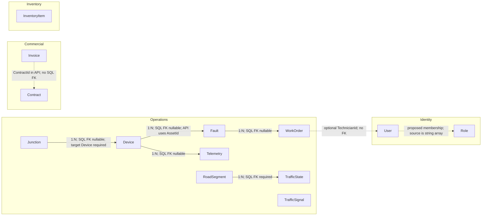

# KinTraffic Domain Relationship Diagram

This document explains the editable source in [domain-model.mmd](./domain-model.mmd). The Mermaid block below mirrors that source for renderers that support embedded Mermaid. Solid arrows correspond to SQL foreign keys; dotted arrows are target/API concepts without an enforced foreign key. Edge labels distinguish current evidence from proposed domain rules.

## Evidence Notes

- `Junction -> Device`, `Device -> Fault`, `Fault -> WorkOrder`, `Device -> Telemetry`, and `RoadSegment -> TrafficState` are declared in `infra/database/schema.sql`; the first four foreign-key columns are nullable, while `TrafficStates.RoadSegmentId` is `NOT NULL`.
- The API instead uses `AssetId` and also carries `Fault.JunctionId`; neither is an enforced C# relationship. The diagram shows the canonical Device terminology but preserves that mismatch in the label.
- `WorkOrder.TechnicianId` and `Invoice.ContractId` are API scalar fields. Neither relationship is present in the current SQL schema.
- The API has no Telemetry entity or endpoint. Its SQL table is the only inspected persistence definition for Telemetry.
- `User` and `Role` are target Identity concepts. Current `UserProfile.Roles` is a string array; there is no Role entity or database relationship.
- No Inventory-to-WorkOrder, TrafficSignal-to-Junction, or TrafficSignal-to-Device relationship was found, so none is drawn.